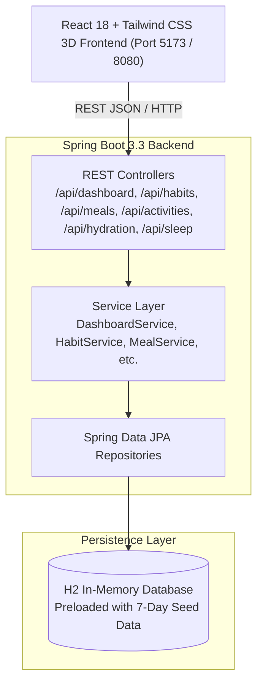

<div align="center">

# Life Ledger

### Personal Wellness & Lifestyle Management Platform

[](https://www.oracle.com/java/)
[](https://spring.io/projects/spring-boot)
[](https://react.dev/)
[](https://vitejs.dev/)
[](https://tailwindcss.com/)
[](LICENSE)

<p align="center">
  A modern, unified wellness command center featuring 3D-inspired cards, real-time health score calculation, habit streak tracking, and holistic routine analytics.
</p>

[Key Features](#key-features) • [Architecture](#architecture) • [Getting Started](#getting-started) • [API Reference](#api-reference) • [Project Structure](#project-structure) • [Roadmap](#future-enhancements)

</div>

---

## Overview

**Life Ledger** bridges the gap between fragmented health tracking tools by bringing daily activities, nutrition, hydration, steps, habits, sleep, and exercise into a unified, interactive dashboard. 

Built with **Java 21 / Spring Boot 3.3** on the backend and **React 18 / Tailwind CSS** on the frontend, Life Ledger emphasizes visual feedback, zero unnecessary code boilerplate, and actionable wellness insights.

---

## Key Features

- **Unified Wellness Score (0–100%)**
  - Dynamically calculated in real-time by weighting step progress, hydration goals, active calorie burns, sleep quality, and daily habit consistency.
  - Interactive 3D SVG circular meter with dynamic tier status badges (*Optimal Flow*, *On Track*, *Needs Focus*).
- **3D Hydration Vessel**
  - Realistic cylindrical vessel featuring animated fluid fill and graduation markers.
  - One-tap quick-add buttons (+250ml cup, +500ml bottle, +750ml flask) for seamless logging.
- **Macronutrient & Fuel Breakdown**
  - Daily caloric budget bar comparing intake against personalized energy goals.
  - Protein, Carbohydrate, and Fat distribution cards with gram weight and calorie percentages.
  - Chronological meal timeline with instant deletion and meal creation.
- **Habit Matrix & Streaks**
  - Track wellness habits across 5 core dimensions: **Mind**, **Body**, **Nutrition**, **Sleep**, and **Focus**.
  - Animated streak flames showing continuous adherence.
  - One-click daily toggle checkboxes that immediately update your overall wellness score.
- **Sleep Architecture Visualizer**
  - Deep Sleep vs. Light/REM phase breakdown.
  - Bedtime and wake-up logs with sleep efficiency score out of 100.
- **Exercise & Workout Log**
  - Workouts categorized by activity type (Running, Walking, Cycling, Gym, Yoga, Swimming, etc.).
  - Calorie burn estimation based on duration and intensity (Low, Moderate, High).
- **7-Day Longitudinal Momentum Chart**
  - Interactive bar chart with metric selector tabs (Overall Score, Steps, Water, Sleep) to visualize progress over time.
- **Quick Logging Dock**
  - Tabbed modal dialog for rapid data entry across all categories from anywhere on the dashboard.

---

## Architecture



---

## Tech Stack

| Component | Technology | Version | Description |
|---|---|---|---|
| **Backend** | Java | 21 / 27 | Core programming language |
| **Framework** | Spring Boot | 3.3.4 | REST API, Data JPA, Validation |
| **Database** | H2 Database | 2.x | Zero-config in-memory relational store |
| **Build Tool** | Apache Maven | 3.9+ | Backend dependency & packaging tool |
| **Frontend** | React | 18.3 | User interface library |
| **Bundler** | Vite | 5.4 | Next-generation frontend tooling |
| **Styling** | Tailwind CSS | 3.4 | Utility-first CSS with custom 3D perspective transforms |
| **Icons** | Lucide React | 0.460 | Clean, lightweight icon suite |

---

## Getting Started

### Prerequisites

Ensure you have the following installed:
- **JDK 21 or higher**: `java -version`
- **Apache Maven 3.8+**: `mvn -version`
- **Node.js 18+ and npm**: `node -v && npm -v`

---

### Option 1: Unified Single-Port Run (Recommended)

The React frontend is built directly into Spring Boot's static resources, allowing you to run the entire application with a single Maven command.

1. **Clone the repository:**
   ```bash
   git clone https://github.com/your-username/life-ledger.git
   cd life-ledger
   ```

2. **Run the Spring Boot application:**
   ```bash
   cd backend
   mvn spring-boot:run
   ```

3. **Access the application:**
   - **Dashboard**: [http://localhost:8080](http://localhost:8080)
   - **H2 Database Console**: [http://localhost:8080/h2-console](http://localhost:8080/h2-console)
     - *JDBC URL*: `jdbc:h2:mem:lifeledger`
     - *Username*: `sa`
     - *Password*: *(empty)*

---

### Option 2: Full-Stack Development Mode (Hot Reloading)

If you plan to modify the React frontend with instant Hot Module Replacement (HMR):

1. **Start the backend:**
   ```bash
   cd backend
   mvn spring-boot:run
   ```

2. **In a separate terminal, start the frontend:**
   ```bash
   cd frontend
   npm install
   npm run dev
   ```

3. **Access the frontend dev server:**
   - [http://localhost:5173](http://localhost:5173) (Proxies `/api` requests to backend on port 8080)

4. **Rebuild static assets for production:**
   ```bash
   cd frontend
   npm run build
   ```
   *(Outputs directly to `backend/src/main/resources/static`)*

---

## API Reference

### Dashboard Endpoints
- `GET /api/dashboard/today` — Retrieve today's unified score, targets, logged meals, workouts, habits, and 7-day trends.
- `GET /api/dashboard?date=YYYY-MM-DD` — Retrieve dashboard metrics for a specific historical date.
- `POST /api/dashboard/steps` — Update daily step count (`{ "steps": 10500 }`).

### Hydration Endpoints
- `GET /api/hydration` — List water logs for today.
- `POST /api/hydration/quick-add` — Rapidly add water volume in ml (`{ "amountMl": 500 }`).

### Habit Endpoints
- `GET /api/habits` — Fetch all habits with current streaks and completion status.
- `POST /api/habits` — Create a new habit (`{ "name": "Cold Shower", "category": "BODY", "targetDaysPerWeek": 7 }`).
- `POST /api/habits/{id}/toggle` — Check or uncheck a habit for today (updates streak dynamically).
- `DELETE /api/habits/{id}` — Delete a habit.

### Meals & Nutrition Endpoints
- `GET /api/meals` — Fetch all meals logged for today.
- `POST /api/meals` — Log a meal:
  ```json
  {
    "mealType": "LUNCH",
    "foodName": "Grilled Salmon & Quinoa",
    "calories": 580,
    "proteinGrams": 42.0,
    "carbsGrams": 38.0,
    "fatGrams": 18.0
  }
  ```
- `DELETE /api/meals/{id}` — Delete a meal entry.

### Workouts & Activity Endpoints
- `GET /api/activities` — Fetch logged workouts.
- `POST /api/activities` — Record physical exercise:
  ```json
  {
    "title": "Evening Trail Run",
    "type": "RUNNING",
    "durationMinutes": 35,
    "intensity": "HIGH"
  }
  ```
- `DELETE /api/activities/{id}` — Delete a workout entry.

### Sleep Endpoints
- `GET /api/sleep` — Fetch sleep analysis for today.
- `POST /api/sleep` — Record sleep session (`bedTime`, `wakeTime`, `durationMinutes`, `quality`).

---

## Project Structure

```
life-ledger/
├── .gitignore                      # Git exclusion rules for Java, Node, IDEs & OS files
├── README.md                       # Repository documentation
├── backend/                        # Java Spring Boot application
│   ├── pom.xml                     # Maven project configuration
│   └── src/
│       ├── main/
│       │   ├── java/com/lifeledger/
│       │   │   ├── config/         # CorsConfig, DataInitializer
│       │   │   ├── controller/     # REST Endpoints
│       │   │   ├── dto/            # Request/Response DTOs
│       │   │   ├── model/          # JPA Entities (Activity, Habit, Meal, etc.)
│       │   │   ├── repository/     # Spring Data JPA Repositories
│       │   │   ├── service/        # Business Logic & Metric Calculations
│       │   │   └── LifeLedgerApplication.java
│       │   └── resources/
│       │       ├── application.properties
│       │       └── static/         # Pre-compiled React production bundle
│       └── test/                   # Spring Boot integration & MockMvc tests
└── frontend/                       # React 18 + Tailwind CSS application
    ├── package.json
    ├── vite.config.js
    ├── tailwind.config.js
    ├── index.html
    └── src/
        ├── components/             # 3D UI cards, charts, and quick-log modal
        ├── services/api.js         # REST API client
        ├── App.jsx                 # Dashboard orchestration
        └── index.css               # 3D perspective styles & animations
```

---

## Future Enhancements

- [ ] **User Authentication & Accounts**: Spring Security with JWT and role-based access.
- [ ] **Personalized AI Coaching**: Smart recommendations and adaptive goals based on historical routine performance.
- [ ] **Cross-Device Sync & Wearables**: Direct synchronization with Apple HealthKit, Google Health Connect, and Garmin Connect.
- [ ] **Export & Reports**: Downloadable monthly PDF and CSV wellness ledger summaries.

---

## License

This project is licensed under the MIT License — see the [LICENSE](LICENSE) file for details.
